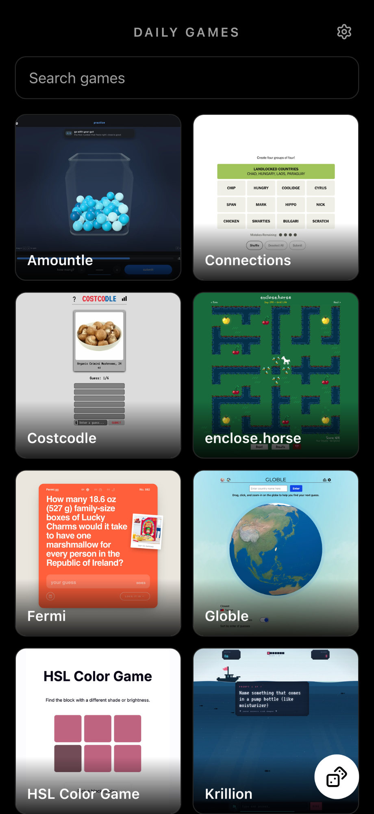

# Daily Games

A museum for daily games.

## Access

The site is live at **https://daily.johnnymayo.com**.

## What it is

Daily Games gathers daily puzzle games from around the web — Wordle, Connections, Globle, Waffle, and more — onto one page. Each game appears as a card with a preview image, and tapping a card opens the game. Taps are counted locally on your device, and the games you open most rise to the top. Use the search box to filter games by title, the dice button to open a random game, or install the site as a PWA from your browser.

## Preview



## Development

The site is an [Astro](https://astro.build) project styled with [Tailwind CSS](https://tailwindcss.com) and uses Node.js 24 (see `.node-version`).

```sh
npm install     # install dependencies
npm run dev     # start the dev server at localhost:4321
npm run build   # build the site to dist/
npm run preview # preview the production build as it deploys
npm run format  # format the code with Prettier
```

Games are listed in `src/content/games.json`; each entry points to a preview image in `src/content/images/`. Pushing to `main` builds and deploys the site to GitHub Pages via the workflow in `.github/workflows/deploy.yml`.

## License

[MIT](LICENSE)
